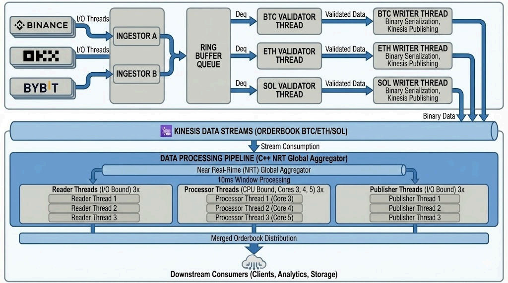
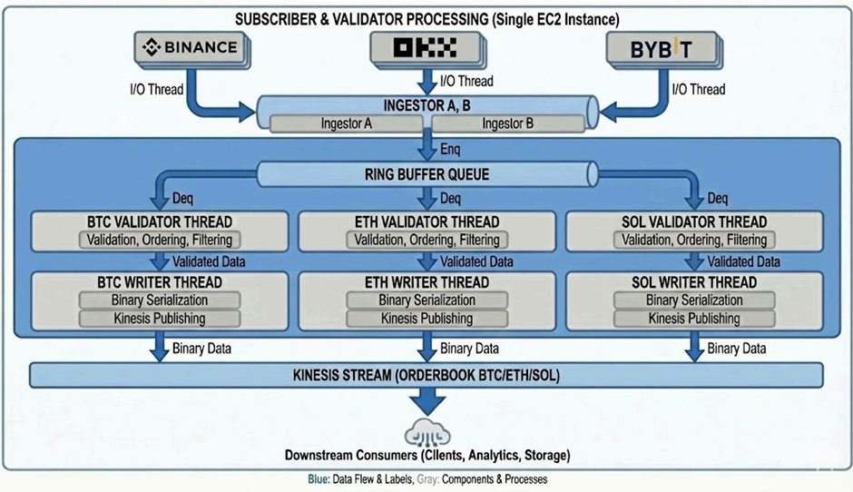
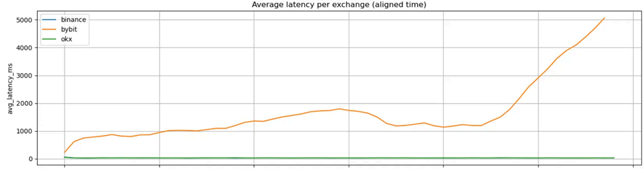
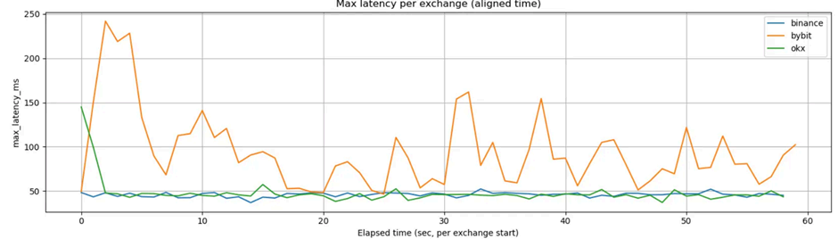
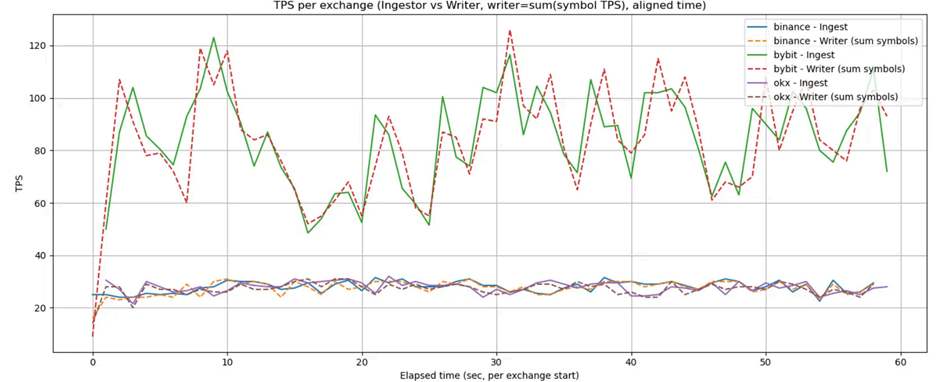
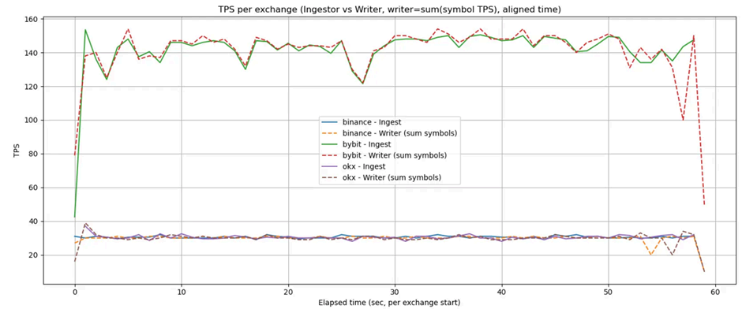
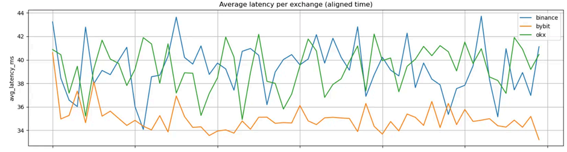

# Live Stream Local OrderBook System
> **C++17 기반 초저지연(Ultra-low Latency) 다중 거래소 실시간 오더북 수집·검증·정규화 및 스트리밍 파이프라인**

[](https://isocpp.org/)
[](https://www.boost.org/)
[](https://protobuf.dev/)
[](https://aws.amazon.com/kinesis/)
[](https://aws.amazon.com/ec2/)

다중 암호화폐 거래소(Binance, Bybit, OKX)에서 비동기적으로 쏟아지는 실시간 호가(Orderbook) 스트림을 무손실 수집·선형화·정규화하여, 다운스트림 글로벌 오더북 집계 엔진`Aggregator`과 트레이딩 시스템이 즉시 소비할 수 있도록 AWS Kinesis Data Streams에 공급하는 고성능 데이터 수집 파이프라인입니다.

---

## Role & Contribution (담당 역할 및 핵심 기여)

본 프로젝트는 실시간 데이터 수집 계층(`Ingestor` ~ `Kinesis`)과 글로벌 오더북 병합 계층(`Aggregator`)으로 역할을 분담하여 진행했습니다.
* **핵심 담당 영역 (Ingestion & Streaming Pipeline):**
  * **Ingestor:** 거래소별(Binance, Bybit, OKX) WebSocket 연결 및 A/B Dual-Stream 이중화 수집 엔진 구현
  * **Validator:** Lock-Free SPSC Queue 기반 스레드 분리, 이기종 시퀀스 검증(`Gap`/`Duplicate` 탐지) 및 `Best Delta` 선형화 알고리즘 설계
  * **Writer & Streaming:** Protobuf 바이너리 직렬화, 하이브리드 배치(`50건 / 100ms`) 및 거래소명 파티션 키 기반 AWS Kinesis 퍼블리셔 구현
  * **Performance Optimization:** `Noisy Neighbor` 병목 해결을 위한 Multi-Process 격리 아키텍처 전환 및 직렬화 포맷 벤치마크 수행
* **Downstream 협업 인터페이스 (`Aggregator` 연계):**
  * 후속 병합 엔진(`Aggregator`)이 거래소별 예외 처리 없이 이벤트 시간(`event_ts`) 기준으로 즉시 글로벌 오더북을 조립할 수 있도록, 단일 `OrderbookDelta` 바이너리 스키마와 샤드 단위 순서가 보장된 클린 스트림을 공급하는 인터페이스 설계

---

## 📑 목차
1. [프로젝트 배경 및 해결 과제](#1-프로젝트-배경-및-해결-과제)
2. [기술 스택 및 선정 근거](#2-기술-스택-및-선정-근거)
3. [전체 시스템 아키텍처](#3-전체-시스템-아키텍처)
4. [핵심 구현 상세 (Ingestor · Validator · Writer)](#4-핵심-구현-상세-ingestor--validator--writer)
5. [트러블슈팅 및 성능 최적화 (Benchmarks)](#5-트러블슈팅-및-성능-최적화-benchmarks)
6. [실행 환경 구성 및 재현성 검증](#6-실행-환경-구성-및-재현성-검증)
7. [향후 고도화 계획](#7-향후-고도화-계획)

---

## 1. 프로젝트 배경 및 해결 과제

24시간 분산 운영되는 암호화폐 시장에서는 동일 자산(`BTC/USDT`, `ETH/USDT`, `SOL/USDT`)이라도 거래소별 유동성 차이에 따라 밀리초(ms) 단위의 가격 괴리가 발생합니다. 이를 포착하기 위한 실시간 데이터 수집 파이프라인을 구축하며 다음 4가지 기술적 난제를 해결하는 데 집중했습니다.

* **네트워크 불완전성 극복 및 데이터 정합성:** WebSocket 패킷 손실, 순서 뒤바뀜(Out-of-Order), 네트워크 지터(Jitter) 환경에서도 단일 선형화(Linearized) 이벤트 스트림 보장
* **이기종 프로토콜 및 시퀀스 체계 통합:** 거래소마다 상이한 스냅샷·델타 규칙, 타임스탬프 포맷, 시퀀스 검증 로직을 단일 내부 스키마로 정규화
* **자원 격리를 통한 예측 가능한 지연(Predictable Latency):** 고빈도 트래픽을 발생시키는 특정 거래소의 부하가 타 거래소 파이프라인에 전파되는 `Noisy Neighbor` 현상 원천 차단
* **고효율 스트리밍 전송:** 대용량 호가 데이터의 직렬화 오버헤드와 네트워크 왕복 지연(RTT)을 최소화하여 AWS Kinesis로 안정적 적재

---

## 2. 기술 스택 및 선정 근거

| 영역 | 기술 스택 | 도입 및 아키텍처 선정 근거 (Trade-off) |
| :--- | :--- | :--- |
| Core Engine | `C++17` | 런타임 GC(Garbage Collection) Pause 배제, 메모리 레이아웃 제어 및 원자적 연산(`std::atomic`) 기반 락프리 큐 활용 |
| Network I/O | `Boost.Asio`, `Boost.Beast`, `OpenSSL` | Thread-per-Connection 기반 동기 블로킹 I/O(`ws.read()`)를 채택해 이벤트 루프 스케줄링 오버헤드 없이 패킷 도착 즉시 수신 |
| Concurrency | `boost::lockfree::spsc_queue`, `CPU Pinning` | `Ingestor → Validator → Writer` 단계 간 1:1 고정 크기(4096) 링 버퍼 통신으로 뮤텍스 락 경합 및 동적 메모리 할당 제거 |
| Serialization | `Protocol Buffers (proto3)`, `nlohmann/json` | 외부 WebSocket 수신 직후에만 최소한의 JSON 파싱을 수행하고, 내부 전송은 바이너리(Protobuf)로 전환해 페이로드 크기 약 50% 절감 |
| Streaming & Infra | `AWS Kinesis Data Streams`, `AWS EC2` | 거래소명 기반 파티션 키(Partition Key) 라우팅으로 샤드 단위 순서 보장 및 EC2 네이티브 멀티프로세스 격리 운영 |

---

## 3. 전체 시스템 아키텍처

전체 시스템은 다음과 같이 구성됩니다.<br>
① 실시간 수집·검증·정규화 계층(담당 영역)<br>
② AWS Kinesis 스트리밍 백본<br>
③ 글로벌 오더북 병합 계층(Downstream Consumer)

<p align="center">
  
  <br>
  <sub><b>[그림 3.1]</b> System Architecture
</sub>
</p>

```text
[Exchanges: Binance / Bybit / OKX]
       │ (Dual WebSocket Streams: Instance A & B, 200ms Staggered Start)
       ▼
┌──────────────────────────────────────────────────────────────────────┐
│ 1. INGESTION & VALIDATION LAYER [담당 설계·구현 영역 / EC2 Native]      │
│  ├─ Multi-Process Isolation: 거래소별 독립 OS 프로세스로 메모리/캐시 격리  │
│  ├─ Ingestor A/B (I/O-Bound): Sync Blocking Read & Common Delta 변환  │
│  ├─ Lock-Free SPSC Queue (Capacity: 4096, Zero Dynamic Allocation)   │
│  ├─ Validator (CPU-Bound): Best Delta 중재, Gap/Dup 검증 및 순서 재정렬  │
│  └─ Writer (I/O-Bound): Protobuf 직렬화 & Hybrid Batching (50건/100ms) │
└──────────────────────────────────────────────────────────────────────┘
       │ (AWS Kinesis Data Streams - Partition Key: Exchange Name)
       ▼
┌──────────────────────────────────────────────────────────────────────┐
│ 2. DOWNSTREAM AGGREGATOR LAYER [협업 연계 영역]                       │
│  └─ Kinesis EFO 스트림 소비 → 7ms Window + 1ms Watermark 글로벌 병합   │
└──────────────────────────────────────────────────────────────────────┘
```

---

## 4. 핵심 구현 상세 (Ingestor · Validator · Writer)

<p align="center">
  
  <br>
  <sub><b>[그림 4.1]</b> Ingestor Architecture
</sub>
</p>

### 4.1. Ingestor: A/B Dual-Stream 이중화 및 SPOF 제거
* 이중 WebSocket 연결: 단일 연결의 패킷 드롭이나 커널 스케줄링 지연을 보완하기 위해 거래소당 두 개의 독립 스레드(`Instance A`, `Instance B`)로 동일 스트림을 이중 수신합니다.
* 시간차 기동(Staggered Start): 두 인스턴스 기동 사이에 200ms 시차를 두어 거래소 API Rate Limiting을 회피하고, 일시적 네트워크 혼잡이 두 스트림에 동시에 발생하는 것을 방지했습니다.
* 자동 복구(Auto-Reconnect): 연결 예외 발생 시 거래소 서버 과부하 방지를 위해 5초 백오프(Backoff) 후 DNS 조회부터 SSL/TLS 핸드셰이크, 초기 스냅샷 재동기화까지 자동 수행합니다.

### 4.2. 이기종 거래소 프로토콜 정규화 및 통합 검증
거래소별로 상이한 오더북 스트림 명세를 수신 직후 공통 `Delta` 구조체로 변환하여 하위 모듈의 거래소 종속성을 완전히 제거했습니다.

| 구분 | Bybit | Binance | OKX |
| :--- | :--- | :--- | :--- |
| 초기 상태 & 갱신 | WebSocket 첫 메시지 `snapshot` + `delta` | REST API 스냅샷 선조회 + `diff-only` | 첫 메시지 `snapshot` + `update` |
| 시퀀스 검증 규칙 | 단조 증가 (`diff == 1` 정상, `diff > 1` Gap) | 업데이트 ID 범위 연속성 검증 (`U ~ u`) | `prevSeqId + 1 == seqId` 및 시퀀스 리셋 허용 |
| 타임스탬프 매핑 | `ts` / `cts` → `Delta.event_ts` | `E` (Event Time) → `Delta.event_ts` | 문자열 `ts` 파싱 → `Delta.event_ts` |

```cpp
// 거래소별 이기종 WebSocket 페이로드를 단일 내부 포맷으로 정규화
struct Delta {
    std::string exchange;      // "bybit", "binance", "okx"
    std::string instance;      // "A" or "B" (이중화 인스턴스 식별자)
    std::string symbol;        // "BTCUSDT", "ETHUSDT", "SOLUSDT"
    int64_t     seq{0};        // 정규화된 시퀀스 번호
    double      event_ts{0.0}; // 거래소 이벤트 생성 시각 (Linearization 기준)
    double      recv_ts{0.0};  // 로컬 시스템 수신 시각 (네트워크 지연 측정 기준)
    std::vector<std::pair<double, double>> bids;
    std::vector<std::pair<double, double>> asks;
};
```

### 4.3. Validator: Best Delta 선택 및 선형화(Linearization) 알고리즘
동일 시퀀스 번호의 데이터가 A/B 양쪽 큐(`QA`, `QB`)에서 도착할 경우, `std::map<int64_t, DeltaPtr>` 기반의 `hold_map`에서 다음 3단계 결정론적 규칙(Deterministic Tie-Break)으로 단일 선형화 지점을 확정합니다.
1. `event_ts`가 더 최신인 Delta 우선: 거래소 매칭 엔진의 실제 이벤트 타임라인 기준 선형성 확보
2. `event_ts` 동일 시 `recv_ts`가 더 빠른 Delta 우선: 네트워크 비대칭 지연으로 인한 Stale 데이터 선택 방지
3. 모두 동일 시 `Instance A` 선택: 무작위성을 배제한 일관된 상태 유지

또한, Peer Wait (`15ms`)로 정상 상황에서 A/B 스트림이 모두 도착할 때까지 대기해 최고 품질의 데이터를 선별하되, 한쪽 스트림이 장기 지연될 경우 Idle Flush (`20ms`)를 통해 강제 방출함으로써 데이터 정확성과 실시간성 간의 트레이드오프를 조율했습니다.

### 4.4. Writer: Hybrid Batching, 파티션 키 전략 및 Graceful Shutdown
* I/O 블로킹 격리: 외부 네트워크(Kinesis) 전송 지연이 CPU 기반 검증(`Validator`)에 역압(Backpressure)을 가하지 않도록 `Cleaned Queue(QC)`를 사이에 두고 별도 `Writer` 스레드로 분리했습니다.
* 하이브리드 배치 전송: 직렬화된 Protobuf 레코드를 메모리 버퍼에 적재한 뒤, 크기 조건(50개 도달) 또는 시간 조건(마지막 전송 후 100ms 경과) 중 먼저 충족되는 시점에 `PutRecords` API로 일괄 전송하여 네트워크 RTT 오버헤드와 최대 지연을 동시에 제어했습니다.
* 파티션 키(Partition Key) 설계: 거래소명을 파티션 키로 지정해 동일 거래소의 이벤트가 단일 Kinesis 샤드로 라우팅되도록 보장함으로써, 다운스트림 `Aggregator`가 시퀀스 역전 없이 안정적으로 데이터를 소비할 수 있게 설계했습니다.
* 무손실 정상 종료(Graceful Shutdown): `SIGINT`/`SIGTERM` 수신 시 `I/O Context → Ingestor → Validator → Writer` 역순으로 스레드를 `join()`하며, 버퍼(`hold_map`, `pending_records_`)에 잔류한 모든 인-플라이트 데이터를 플러시한 후 안전하게 종료합니다.

---

## 5. 트러블슈팅 및 성능 최적화 (Benchmarks)

### Case 1. 단일 프로세스 내 'Noisy Neighbor' 병목 현상 해결
* 문제 상황 (Problem): 초기 Single-Process 9-Thread 구조에서 호가 업데이트 빈도가 가장 높은 Bybit의 JSON 파싱·정렬 부하가 L3 캐시 스래싱(Cache Thrashing)과 메모리 할당자 경합을 유발했습니다. 이로 인해 부하가 적은 Binance와 OKX의 지연까지 180ms 이상 흔들리고, Bybit의 최대 지연이 **5,000ms 이상** 폭증하는 Noisy Neighbor 현상이 발생했습니다.
* 해결 방법 (Action): 스레드 분리만으로는 메모리·캐시·스케줄러 경합을 해결할 수 없다고 판단하여, 거래소별 파이프라인을 독립된 OS 프로세스(Multi-Process)로 완전히 격리했습니다.
* 개선 결과 (Result): 프로세스별 힙 메모리와 캐시 영역이 독립되면서 Bybit의 5,000ms 지연 스파이크가 완전히 소멸했고, 전 거래소 평균 지연이 **0~45ms** 수준으로 평탄화되었습니다.

<p align="center">
  
  <br>
  <sub><b>[그림 5.1]</b> Average latency per exchage in Single Process
</sub>
</p>

<p align="center">
  
  <br>
  <sub><b>[그림 5.2]</b> Average latency per exchage in Multi Process</sub>
</p>

### Case 2. JSON 텍스트 포맷에서 Protobuf 바이너리 직렬화 전환
* 문제 상황 (Problem): JSON 텍스트 포맷은 페이로드 크기가 커서 TCP 세그먼트 증가 및 네트워크 큐 적체를 유발하고, 직렬화/역직렬화 시 문자열 디코딩 오버헤드로 인해 버스트 구간에서 평균 지연이 80~180ms까지 튀는 지터가 발생했습니다.
* 해결 방법 (Action): `orderbook.proto` 스키마를 정의하고 바이너리 직렬화로 전환했습니다.
* 개선 결과 (Result): 전송 페이로드 크기 약 50% 감소, 파싱 오버헤드 제거를 통해 고부하 구간에서도 Ingest-Writer 처리율이 1:1로 일치하며 평균·최대 지연이 34~44ms 범위로 수렴했습니다.

<p align="center">
  
  <br>
  <sub><b>[그림 5.3]</b> TPS per exchange in Multi Process</sub>
</p>
<p align="center">
  
  <br>
  <sub><b>[그림 5.4]</b> TPS per exchange in Multi Process & Binary</sub>
</p>
<p align="center">
  
  <br>
  <sub><b>[그림 7]</b> Average latency per exchage in Multi Process & Binary</sub>
</p>

### 단계별 아키텍처 개선 성과 요약

| 개선 단계 | 아키텍처 및 데이터 포맷 | 평균 지연 (Avg Latency) | 최대 지연 (Max Latency) | 핵심 개선 효과 |
| :--- | :--- | :---: | :---: | :--- |
| Baseline | Single-Process + JSONL | 180ms ~ 5,000ms+ | > 5,000ms | Noisy Neighbor 및 큐 적체로 지연 폭증 |
| Step 1 | Multi-Process 격리 + JSONL | 30ms ~ 50ms | ~240ms | 거래소 간 자원 간섭 제거 및 초 단위 스파이크 해결 |
| Step 2 (Final) | **Multi-Process + Protobuf + Batching** | **34ms ~ 44ms** | **< 100ms** | **페이로드 50% 절감, 전 구간 지연 평탄화 달성** |

---

## 6. 실행 환경 구성 및 재현성 검증

> Note on Infrastructure & Reproducibility (인프라 및 실행 검증 안내)<br> 
> 본 시스템은 프로세스 간 캐시 격리와 호스트 OS 레벨 코어 친화도 제어를 온전히 확보하기 위해 컨테이너 가상화 계층 없이 AWS EC2 네이티브 환경 및 AWS Kinesis Data Streams 위에서 직접 빌드·구동되었습니다. 또한 외부 환경에서 AWS 유료 리소스 없이도 오더북 검증 및 정규화 로직을 테스트할 수 있도록 `IPublisher` 추상화 인터페이스를 통한 로컬 파일 출력 모드 `FilePublisher`를 지원합니다.

### 프로젝트 디렉터리 구조
```text
├── proto/                      # Protobuf 스키마 명세 (orderbook.proto)
├── src/
│   ├── ingestor/               # 거래소별 WebSocket 수집기 (Binance, Bybit, OKX)
│   ├── validator/              # A/B 스트림 중재(Best Delta), Gap/Dup 검증 및 선형화
│   ├── writer/                 # Protobuf 직렬화, Hybrid Batching, IPublisher 구현체
│   ├── aggregator/             # Downstream 글로벌 오더북 병합 엔진
│   └── common/                 # SPSC Queue, 공통 Delta 구조체, 유틸리티
├── scripts/                    # EC2 환경 의존성 설치 및 거래소별 멀티프로세스 실행 스크립트
├── docs/                       # 시스템 아키텍처 다이어그램, 벤치마크 차트, 실행 로그
└── CMakeLists.txt              # C++17 빌드 설정
```

### EC2 환경 빌드 및 멀티프로세스 실행 방법
```bash
# 1. 환경 변수 템플릿 복사 (AWS Kinesis 연동 시 자격 증명 및 스트림명 입력)
cp .env.example .env

# 2. CMake Release 빌드
mkdir -p build && cd build
cmake -DCMAKE_BUILD_TYPE=Release ..
make -j$(nproc)

# 3. 거래소별 독립 Ingestor 프로세스 실행
./ingestor --exchange bybit &
./ingestor --exchange binance &
./ingestor --exchange okx &
```

---

## 7. 향후 고도화 가능성

1. Object Pool 기반 Zero-Allocation 최적화: 현재 수신 시마다 `std::make_shared`로 동적 할당되는 `Delta` 객체를 사전 할당된 Object Pool에서 재사용하도록 전환하여 힙 할당자 경합 추가 제거
2. 하드웨어 친화적 최적화 (NUMA & CPU Pinning): Linux 환경에서의 `pthread_setaffinity_np` 기반 코어 고정 활성화 및 NUMA 노드 로컬 메모리 할당을 통한 캐시 히트율 극대화
3. 실시간 관측성(Observability) 파이프라인 구축: 거래소별 TPS, P50/P99/P99.9 지연 분포, `Gap`/`Duplicate` 발생률을 시계열 지표로 수집해 임계치 초과 시 자동 알림을 발송하는 운영 모니터링 체계 구축


